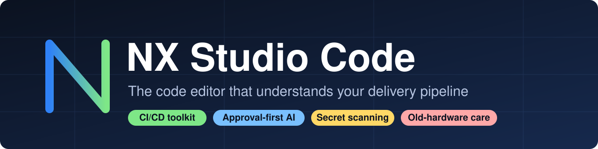
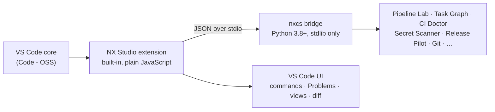

<p align="center">
  
</p>

<h3 align="center">The code editor that understands your delivery pipeline.</h3>

<p align="center">
  A VS Code–based editor with a built-in CI/CD toolkit, release tooling, secret scanning
  and an approval-first AI agent — designed to stay fast on modest and old hardware.
</p>

<p align="center">
  <a href="https://github.com/Barman-Zarei/NX-Studio-Code/actions/workflows/ci.yml"></a>
  <a href="https://github.com/Barman-Zarei/NX-Studio-Code/actions/workflows/ci.yml"></a>
  
  
  
</p>

<p align="center">
  <a href="#why-nx-studio-code">Why</a> ·
  <a href="#highlights">Highlights</a> ·
  <a href="#editions">Editions</a> ·
  <a href="#getting-started">Getting started</a> ·
  <a href="#command-reference">Commands</a> ·
  <a href="#architecture">Architecture</a> ·
  <a href="#project-status">Status</a> ·
  <a href="#faq">FAQ</a>
</p>

---

## Why NX Studio Code

Modern editors are excellent at writing code and leave the rest of the job — running the pipeline, checking the
workflow files, cutting a release, making sure no key slips into a commit — to a pile of terminals, web pages and
extensions.

**NX Studio Code puts that whole loop inside the editor.** It is a fork of the MIT-licensed
[Code - OSS](https://github.com/microsoft/vscode) (the open-source core of VS Code) that ships one built-in extension,
**NX Studio**, with the tooling a developer needs between "it works on my machine" and "it is released":

- run your **GitHub Actions workflows locally** and see exactly what *cannot* run locally;
- lint those workflows for **supply-chain and injection mistakes** before you push;
- run a **dependency-aware task graph** with parallelism and failure propagation;
- **scan for secrets**, review code, run tests and prepare **releases** without leaving the window;
- let an **AI agent propose changes — but never write a byte without your explicit approval**;
- keep working on **old or weak machines** with profiles, a safe-graphics mode and a compatibility doctor.

Everything is **offline-first and private by default**: telemetry and update checks are off, extensions come from
[Open VSX](https://open-vsx.org), and nothing destructive happens without a confirmation.

## Highlights

| | |
|---|---|
| **Pipeline Lab** | Executes the `run:` steps of `.github/workflows/*.yml` locally in `needs` order. Reports honestly which parts (`uses:`, matrices, services, secrets, expressions) were **not** executed. |
| **Task Graph** | A small DAG runner (`.nx/tasks.json`): concurrent independent tasks, failed dependencies skip their dependents, cycles are detected before anything runs. |
| **CI Doctor** | Static workflow linter: unpinned actions, missing `permissions`, `pull_request_target` + PR checkout, `${{ github.event… }}` script injection, missing timeouts. |
| **Secret Scanner** | Finds likely credentials (cloud keys, tokens, private keys, JWTs, hard-coded secrets). Findings are **masked** and never echoed in full. |
| **Release Pilot** | Semantic version bump, changelog from git history and a release checklist. It **never** tags, pushes or publishes on its own. |
| **Git Command Center** | Status, diff, stage, commit, branches, merge, conflicts — with modal confirmation for every destructive action. |
| **Claude Ask & Project Agent** | Draft → diff view → explicit approval → conflict-safe apply. API key lives in the OS keychain. Fully optional (`nx.claude.enabled`). |
| **Hardware care** | Studio profiles (`low-resource`, `legacy-safe`, `offline`), Compatibility Doctor and Safe Graphics Mode for old GPUs. |

Plus code review, test runner, dependency guardian, project forge, log explorer, profiler and a localhost-only live
preview — see the [command reference](#command-reference).

## Editions

This repository has two long-lived branches. They carry the **same NX layer** (extension, branding, defaults, docs and CI)
and differ only in the VS Code engine underneath.

| | `main` | `LEGACY` |
|---|---|---|
| **Source** | Latest upstream snapshot (VS Code 1.143.0) | The same snapshot plus a compatibility layer |
| **Electron** | 43 | 22.3.27 (Chromium 108, Node 16) |
| **Targets** | Windows 10+, Linux, macOS | Windows 7 SP1+ (x64) and older hardware |
| **Maturity** | NX layer tested; editor build in progress | **Experimental** — never booted on Windows 7 yet |
| **Use it when** | You are on a current OS | You cannot move off an old OS and accept the limits |

`LEGACY` exists because Electron 23+ dropped Windows 7, while VS Code's main process needs ES-module support that
Electron only has from version 28. The compatibility layer converts the node-side bundles to CommonJS, lowers the renderer to
Chromium 108 and shims the missing runtime APIs. Details, the verified/unverified list and the known limits are in
[`docs/LEGACY.md`](docs/LEGACY.md).

> **Heads-up for Windows 7:** Chromium 108 no longer receives security fixes. Keep Workspace Trust on, avoid untrusted web
> content, and prefer `main` wherever Windows 10+ is available.

## Getting started

### Requirements

| For | You need |
|---|---|
| Using the NX features | **Python 3.8+** and **Git**. On Windows, **Git for Windows** (its `bash` runs pipelines and tasks; the WSL launcher is deliberately not used). |
| Building the editor | Node.js as pinned in [`.nvmrc`](.nvmrc), ≥ 8 GB RAM, a C++ toolchain (MSVC Build Tools on Windows, `build-essential` and a few `-dev` packages on Linux). See [`docs/BUILDING.md`](docs/BUILDING.md). |

### Get a build

1. Open the **Actions** tab and run the **build** workflow on the branch you want (or push a `v*` tag to also create a release).
2. Download the Windows installer or zip (or the Linux tarball) from the run's **Artifacts**.
3. Install it, or unzip into a **short path** such as `C:\nx`.

Release binaries will be attached to GitHub Releases once the build pipeline has been proven end to end.

### Try the NX layer without building the editor

```bash
git clone https://github.com/Barman-Zarei/NX-Studio-Code.git
cd NX-Studio-Code

# Python core (stdlib only)
cd extensions/nx-studio/python && python -m unittest discover -s tests -v && cd ../../..

# Extension against a fake VS Code API and the real core
node extensions/nx-studio/test/smoke.js
```

> **Windows tip:** the repository contains deeply nested paths. Enable long paths once with
> `git config --global core.longpaths true` and clone into a short folder (e.g. `C:\nx`).

### First minute in the editor

1. Click **`NX 1.0.0`** in the status bar (or press <kbd>F1</kbd> and type `NX:`) to open the command menu.
2. Run **NX: Compatibility Doctor** to get a report and a recommended profile for your machine.
3. Open a project with `.github/workflows` and run **NX: CI Doctor: Lint Workflows**, then **NX: Pipeline Lab: Run Workflow Locally**.
4. Optional: **NX: Claude: Set API Key**, then **NX: Claude: Project Agent** on an open file.

## Command reference

All commands live in the Command Palette under the **NX** category.

| Area | Command | What it does |
|---|---|---|
| **CI/CD** | Pipeline Lab: Run Workflow Locally | Runs selected jobs (with their `needs`) of a workflow, streaming output |
| | Pipeline Lab: Inspect Workflow | Shows jobs, dependencies and what cannot be run locally |
| | CI Doctor: Lint Workflows | Security/hygiene findings in the Problems panel |
| | Task Graph: Run / Create `.nx/tasks.json` | DAG task runner with failure propagation |
| | Release Pilot | Version bump, changelog and checklist (no tag, no push) |
| **Quality** | Review Current File | Static review findings in the Problems panel |
| | Scan Workspace for Secrets | Masked credential candidates |
| | Run Tests (Test Intelligence) | Runs `unittest`, maps failures to source lines |
| | Dependency Guardian | Outdated packages with upgrade-risk notes |
| **Git** | Git Command Center | Everyday Git with confirmation for destructive actions |
| **AI** | Claude: Set API Key / Ask | Keychain-stored key; ask about a selection |
| | Claude: Project Agent | Rewrite a file: draft → diff → approval → conflict-safe apply |
| **Project** | Project Forge | New `python`, `cli`, `web` or `c` project |
| | Log Explorer | Filter by level/regex; sanitize before sharing |
| | Profile Current Python Script | Time and memory hot spots |
| | Live Preview | Static server bound to `127.0.0.1` only |
| | Analyze Project | Languages, entry points, build files, dependencies |
| **Machine** | Apply Studio Profile | `python`, `web`, `cpp`, `low-resource`, `legacy-safe`, `offline` |
| | Compatibility Doctor | OS / RAM / CPU / Python report with recommendations |
| | Safe Graphics Mode | Toggles software rendering for old GPUs (restart required) |

Per-feature status and honest limits: [`docs/NX-FEATURES.md`](docs/NX-FEATURES.md).

## Architecture



- **A thin editor layer.** The extension only talks to the VS Code API (kept compatible with old engines) and renders results
  as Problems, views, diffs and notifications.
- **A testable core.** All logic lives in `nxcs`, a dependency-free Python package behind a single JSON bridge
  (`python -m nxcs.bridge <method>`): streamed events, one final result, never a silent crash. It is unit-tested without an editor.
- **Safety by construction.** Destructive operations require explicit confirmation; the AI agent cannot write without an approved diff;
  pipelines run with a scrubbed environment and timeouts (a guard rail, **not** a sandbox).

### Repository layout

```
extensions/nx-studio/     the built-in extension
  extension.js              commands, views, diagnostics, status bar
  python/nxcs/              the core: bridge, pipeline, taskgraph, cilint, secretscan, releasepilot, gitcc, …
  python/tests/             unit tests (stdlib unittest)
  test/smoke.js             extension smoke test with a fake VS Code API
nx/                       branding script, CI helper, LEGACY test and audit tools
docs/                     features, LEGACY status, build guide
.github/workflows/        ci.yml (tests, lint) and build.yml (editor build)
```

## Project status

NX Studio Code is **1.0.0 and young**. What that means in practice:

| Area | State |
|---|---|
| NX core (Python) | Unit-tested; CI runs it on Linux and Windows with Python 3.8 and 3.12 |
| NX extension | Smoke-tested against a fake VS Code API (25 commands registered and exercised) |
| Editor build (`build.yml`) | Written from upstream's pipelines; **being proven** — expect fixes on first runs |
| `LEGACY` engine port | Compatibility code written and unit-tested; **not yet booted on real Electron 22 / Windows 7** |
| Claude features | Code paths tested with a mock transport; no live-API verification yet |
| Branding | Product name, version and defaults done; **icons are still the Code - OSS defaults** |

**Roadmap**

- [ ] First fully green editor build on `main`, published as GitHub Releases
- [ ] First verified boot of `LEGACY` on Windows 7 hardware
- [ ] Own icon set and installer artwork
- [ ] Per-hunk patch selection in the Project Agent UI
- [ ] GitHub bridge (PRs and workflow runs inside the editor)
- [ ] Interactive Windows 7 terminal beyond the basic piped fallback

## Development

```bash
# NX core and extension
cd extensions/nx-studio/python && python -m unittest discover -s tests -v
node extensions/nx-studio/test/smoke.js

# LEGACY branch only: compatibility layer (Node ≥ 22.18)
node nx/test-polyfills.mjs && node nx/test-compat.mjs
ESBUILD=<path-to-esbuild-package> node nx/verify-cjs-bundles.mjs
```

Branding is applied idempotently with `node nx/brand.cjs . main|legacy`. Keep the engine version in `package.json`
untouched so extension compatibility checks keep working; the NX release version is `product.json › nxVersion`.

Issues and pull requests are welcome. Please keep changes small, add a test next to the code you touch, and describe
anything you could **not** verify.

## FAQ

**Is this an official Microsoft product?**
No. It is an independent fork of Code - OSS and is not affiliated with or endorsed by Microsoft. "Visual Studio Code" is a trademark of Microsoft.

**Can I use the Microsoft Marketplace?**
No — its terms do not allow other products to use it. NX Studio Code uses [Open VSX](https://open-vsx.org). Some extensions (for example Copilot) are not available there.

**Why a Python core instead of TypeScript?**
It keeps the logic small, dependency-free and testable without an editor, and it runs on Python 3.8 — the last version for Windows 7. The extension itself is plain JavaScript with no build step.

**Does Pipeline Lab replace GitHub Actions?**
No. It runs the shell steps locally for fast feedback and tells you what it skipped. Treat a green local run as a hint, not a guarantee.

**Does the AI agent send my code anywhere by itself?**
Only when you use a Claude command, and only the file/selection you chose. It cannot modify files without an approved diff, and you can disable it entirely.

**Will it run on Windows 7?**
That is the goal of the `LEGACY` branch; it is **not verified yet**. See [`docs/LEGACY.md`](docs/LEGACY.md) for the honest list of open items.

## License and credits

- NX additions © Barman — [MIT](LICENSE.txt). Upstream Code - OSS is MIT-licensed and kept unchanged.
- Vendored: PyYAML 6.0.2 (MIT), used as a pure-Python fallback.
- See [`NOTICE.md`](NOTICE.md) and [`CHANGELOG.md`](CHANGELOG.md).

<p align="center">
  Built by <a href="https://github.com/Barman-Zarei"><b>Barman</b></a> · standing on the shoulders of Code - OSS
</p>
